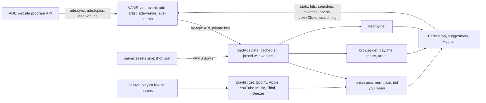

<!--
  PROJECT.md — the living map of this repo. One file to open and know where things stand.
  Maintained by the `project-map` skill. The assessment (status/issues/roadmap) is refreshed
  each session; the Diary at the bottom only grows. App-code changes need a green light;
  main is merged to only when sure.
-->
<!-- clickup_list: not linked yet -->

# hiren.ninja — map

**What it is** · Hiren's site at [hiren.ninja](https://hiren.ninja): home, about, services (request form), projects gallery, contact, experiments (Three.js LED-sculpture generator) and the **ADE Planner** at `/ade-planner`, a free fan tool that matches your playlist against the Amsterdam Dance Event 2026 program.
**Stack** · Nuxt 4 · Vue 3 · Tailwind 3 · Nitro on Netlify · Three.js + Vanta (birds) · Leaflet (plan map, lazy) · Umami (cookieless) · Vitest.
**Content** · Projects and the whole ADE program come from **VAMS** (`koala/VAMS`, app.use-vams.me) through server routes with a private key; bundled snapshots in `server/assets/` are the fallback. Leads (contact + service forms) become **ClickUp** tasks. Services and skills are hardcoded.
**Status** · 🟢 `main` builds, deploys and is live; 30 Vitest tests, ESLint clean (0 errors). ADE Planner launched 1 Oct (Reddit): 191 real searches, 78 playlists, 44 stars by 10 Oct.
**Repo** · `koala/hiren-ninja` · GitHub `Hersh3yy/hiren-ninja` · one branch: **`main`** (small, tested commits straight to main this sprint, with Hiren's go).
**Package manager** · **npm** (`package-lock.json`).
**ClickUp** · roadmap not linked; leads list "Contact Form Submissions" (id 901507749589) via `CLICKUP_API_KEY`/`CLICKUP_LIST_ID` on Netlify.
**Last assessed** · 2026-10-11

---

## Run it

```bash
npm install
npm run dev          # http://localhost:3000 (VAMS_API_URL + VAMS_API_KEY in .env for live data)
npm test             # vitest run (30 tests: matching, playlists, timetable, travel, nearby, topics)
npm run lint         # eslint (raw <button>/<a>/<input> outside atoms/molecules is an error)
npm run build
```
Gotchas: Nitro caches the ADE data for an hour (`ade-planner-data`); after a VAMS change, restart dev or delete `.nuxt/cache/nitro/functions/ade-planner-data`. A Tailwind config change can kill `nuxi dev`; restart it. ADE data refresh lives in VAMS (`php artisan ade:sync --reuse-pages`, see VAMS's map).

## Status

The site is in good shape after a two-week sprint: secrets moved to env (the leaked ClickUp token was rotated), Hygraph is gone, OG images, JSON-LD, canonicals and llms.txt are in, interactive HTML is lint-locked into atoms/molecules, modals/menu/accordion use native `<dialog>`/`popover`/`<details>`. The ADE Planner is the active product: playlists from five services, typo-tolerant matching, a daytime tab with topics, school-timetable views, a week plan with travel times, a map, "near me" and a story image. What's left is mostly old experiment debt (LSS WebGL disposal), two unused deps, and turning the ADE data into a few posts before 21 Oct.

## Issues

| Sev | Issue | Where |
|---|---|---|
| warning | **LSS WebGL leaks**: geometries/materials rebuilt per parameter change are never `.dispose()`d; unmount only disposes the renderer. | `app/components/LSS/Viewer.vue` (only `renderer.dispose()` at :377) |
| warning | **Undocumented third-party endpoints** carry the planner: Spotify web-player `spclient` (tracks past 100), Tidal's public web token, YouTube Music/Apple page data. Any can change without notice; the planner degrades to "partial" and says so. | `server/utils/ade-planner/playlist.ts`, `tidal-deezer.ts`, `youtube-music.ts` |
| warning | ADE data only refreshes when someone runs `ade:sync` in VAMS (no schedule, on purpose); new daytime events then need `ade:topics`. | VAMS `routes/console.php` (empty), VAMS map |
| note | Unused deps `axios`, `howler`. | `package.json` |
| note | Majors waiting: Tailwind 4, Vitest 5, ESLint 10, `nuxt-site-config` 4; `three` pinned at 0.134 by `vanta`. Minor: nuxt 4.6.1, sitemap 8.6.1, robots 6.2.4. | `npm outdated` |
| note | Mystic Garden and Dockyard Festival are one event that ADE lists twice; the planner shows both. | ADE data |

## Guide

- **Pages:** `app/pages/*` under `layouts/default.vue` (Vanta birds: full on the home hero, calm elsewhere; header with `popover` phone menu; footer). Canonical, `og:url`, JSON-LD (Person, ProfessionalService, WebSite) in the layout; WebApplication on `/ade-planner`. Home, about, services, projects and contact are ISR-cached on Netlify (hourly).
- **Design system:** `app/components/{atoms,molecules,organisms}` plus feature folders (`AdePlanner/`, `LSS/`, `Experiments/`). Rules in `app/components/README.md`: props over slots, interactive HTML only in atoms/molecules (lint), native HTML first.
- **Projects:** `server/api/projects.get.ts` → `server/utils/projects.ts` → VAMS `projects` entries, snapshot fallback.
- **Leads:** `server/api/{contact,service-request}.post.ts` → `server/utils/leads.ts` → ClickUp task (markdown description, tags, priority), rate-limited per IP.
- **ADE Planner:** `app/components/AdePlanner/*` (Tool → Parties/Daytime panels, MyPlan, NearMe, Timetable) and `server/api/ade-planner/*`:



- **My plan:** favorites in `localStorage` (`useAdeFavorites`), shown as a week timetable, list or map; clashes, getting-around times (`server/utils/ade-planner/travel.ts`), `.ics` export and a story image (`app/utils/storyImage.js`). Timetable maths in `app/utils/timetable.js`.
- **Analytics:** Umami events (`app/utils/track.js`), plus anonymous counters and the search log in VAMS (what, never who).

## Hard parts

### Reading Spotify playlists past 100 tracks
🔭 The public embed page ships the first 100 tracks and an anonymous token. `api.spotify.com` answers that token with a ~20 h 429 (QUOTA_EXCEEDED), but the web player's `spclient` endpoints accept it: one call for the whole track list (URIs), then `metadata/4/track/{gid}` per track for the artists, 50 in parallel, newest first, inside a 6 s budget. The gid is the base62 track id rewritten as 32-char hex (`spotifyGid`, BigInt).
⚖️ The official API refuses playlists the caller doesn't own (owner/collaborator only, no app-only keys), so there's no "proper" way for a shared playlist.
🗣️ *"We read what Spotify's own web player reads, with the embed's anonymous token, and degrade to the first 100 tracks with a visible note when that breaks."*

### Which day does a 01:00 party belong to?
🔭 `planningDay()` shifts a party that starts before 06:00 to the previous date, and `minutesOnDay()` measures from that day's midnight, so Friday 01:00 is Thursday 1500 (25:00). Day differences are computed between two date keys, so the switch to winter time on Sun 25 Oct (a 25-hour day) still rounds to one day. Overlapping items get lanes by interval partitioning (`layoutLanes`), the same thing a school timetable does with rooms.
🗣️ *"Nights belong to the evening they start in, so the timetable runs past 24:00 instead of splitting a party over two days."*

### Counting without knowing who
🔭 Stats (artist hits/searches, event favorites/opens/ticketClicks, one `ade-search` entry per search) go to VAMS through one keyed write endpoint; the browser never talks to VAMS. Repeat clicks are deduped per IP+event per serverless instance in memory, and no IP is stored. Stats are sent even while the site runs on the snapshot, because it carries the same VAMS ids.
🗣️ *"Counts and queries, never identities; dedupe in memory, store nothing personal."*

### Topics by judgment, kept across syncs
🔭 ADE's own labels are too generic, so each daytime event got 1-3 of 16 topics by reading it (Claude, via `ade:topics` in VAMS). `ade:sync` preserves `topics`, so only new events need classifying (`ade:topics --missing`).
🗣️ *"A human-quality taxonomy, applied once and kept, instead of keyword rules that misfire."*

## Roadmap — near future

### Launch and growth (before ADE, 21-25 Oct)
- [ ] Post the "most wanted acts not at ADE" story (Chris Lake, Bicep, Fred again.., Fisher) on Instagram + LinkedIn <!-- id:g1 -->
- [ ] Second sharing wave around 14 Oct with the timetable and story image <!-- id:g2 -->
- [ ] Email Bravoure (draft ready in the 1 Oct chat) <!-- id:g3 -->
- [ ] Add Instagram/LinkedIn links to footer + JSON-LD `sameAs` once the accounts exist <!-- id:g4 -->
- [ ] DMARC TXT record at Porkbun (`_dmarc`, `v=DMARC1; p=none; rua=mailto:hello@hiren.ninja`) (Hiren) <!-- id:g5 -->
- [ ] ~300 more words on the home page (thin content, GEO) from Hiren's notes <!-- id:g6 -->

### ADE Planner
- [x] Calendar export (.ics) <!-- id:a12 -->
- [x] Venue geocoding and a map (PDOK + Amsterdam geosearch, Leaflet) <!-- id:a13 -->
- [x] Day timetable with clashes and gaps <!-- id:a14 -->
- [x] Interest search for the daytime tab (tags, genres, topics, did-you-mean) <!-- id:a11 -->
- [ ] Share-my-plan link (encode saved ids in the URL, no login) <!-- id:a15 -->
- [ ] Merge events ADE lists twice (same lineup, venue and time) <!-- id:a16 -->
- [ ] Re-sync before and during ADE week (`ade:sync`, `ade:topics --missing`, `ade:venues`, export snapshot) <!-- id:a17 -->

### Site
- [ ] Remove unused `axios` + `howler`; take nuxt 4.6, sitemap 8.6, robots 6.2.4 <!-- id:n8 -->
- [ ] LSS WebGL disposal (dispose geometry/material on rebuild; `forceContextLoss()` on unmount) <!-- id:f2 -->

## Roadmap — far future

- [ ] Major upgrades behind the build/test check: Tailwind 4, Vitest 5, ESLint 10, `nuxt-site-config` 4 <!-- id:f6 -->
- [ ] Real blog content (or keep `/blog` noindexed) <!-- id:f5 -->
- [ ] Optional logins: Spotify (dev-mode user cap), Apple Music ($99/yr) <!-- id:a6 -->
- [ ] After ADE: turn the planner into a reusable "festival planner" (any program feed) <!-- id:a18 -->
- [ ] Link a ClickUp list + sync this roadmap <!-- id:f7 -->
- [x] Hygraph → VAMS migration (projects) <!-- id:f1 -->
- [x] Rotate + env-ize secrets (ClickUp, VAMS key; Hygraph removed) <!-- id:n3 -->
- [x] OG images, apple-touch-icon, canonical, JSON-LD <!-- id:n4 -->
- [x] Perf: portrait 2.4 MB → 8-37 KB `<picture>`, fonts via `<link>`, ISR <!-- id:n5 -->
- [x] a11y pass (axe 0 violations, native dialog/popover/details, reduced motion) <!-- id:n6 -->
- [x] Service-request double submit (forms now post to Nitro routes) <!-- id:f3 -->
- [x] Atomic-design cleanup, lint-enforced <!-- id:f4 -->

---

## Diary

### 2026-10-11 — timetables, venues, map, near me, story image; data resync
- School-timetable views: daytime tab List/Timetable (a column per venue, ADE Pro first, overlapping sessions get "rooms"); My plan as a week timetable (Wed-Sun, after-midnight parties on the night before) with clash warnings. Blocks open the full event in a native dialog. "Save to my plan" button in every opened event.
- `.ics` calendar export of My plan; "Share as story image" (1080x1920 canvas, share sheet on touch devices, download on desktop).
- Venues: VAMS `ade:venues` geocodes each venue once (PDOK, restricted to Amsterdam when the address says so; district from Amsterdam's geosearch; north-of-the-IJ flag). The planner joins them in: area filter now covers most events (Fri Centre 16 → 102), "Getting around" between saved events (walk/bike/ferry estimate, red when the gap is too short, public-transport hint past 6 km), a Leaflet map of the plan (OSM tiles, darkened), and "Near me" (`/api/ade-planner/nearby`, preview of Fri 23 Oct 22:00 before ADE).
- CARTO's dark tiles now need a key, so the map uses OSM tiles with a CSS filter.
- Search report artifact refreshed: 191 searches, 78 playlists, 14,413 tracks, 469 events reached, 103 opens, 52 ticket clicks, 44 stars.
- ADE resync (before/after diff): events 1,405 -> 1,602 (+206 new, 121 of them daytime, 72 ADE Pro; 9 dropped by ADE, incl. Amsterdam Rave and Luciano ALIVE), artists 4,154 -> 4,504, sold out 36 -> 45 (DGTL Thu/Fri, Warhaus, Christian Löffler). 13 start-time and 21 end-time changes, 99 lineups changed. 106 new daytime events classified into topics; no new venues to geocode. Snapshot re-exported.

### 2026-10-01 — native HTML, stricter atomic design, SEO and load
- Interactive HTML only in atoms/molecules, lint-enforced (`vue/no-restricted-html-elements`). AtomsButton `variant="link"`/`"link-muted"` and `to`; footer on MoleculesNavLink.
- Native platform over our own JS: modals on `<dialog>` (deleted the 165-line `useModalA11y.js`), phone menu on `popover`, experiments accordion on `<details name>`, card-to-dialog image morph on the View Transitions API (no cloned image).
- SEO: JSON-LD (Person, ProfessionalService, WebSite; WebApplication on /ade-planner), canonical + `og:url` per page, `og:image:alt`/size, `/blog` stub noindexed and out of the sitemap.
- Load: about portrait 2.4 MB JPEG -> 8-37 KB AVIF/WebP/JPEG `<picture>` with width/height; fonts via one `<link>` instead of CSS `@import`s; first row of project covers eager + `fetchpriority`, the rest lazy.
- Suggestions grouped by day; birds stay (calm off the home hero).
- Spotify playlists past 100 tracks again: api.spotify.com gives the embed token a ~20h 429 (QUOTA_EXCEEDED), so tracks 101+ now come from the web player's spclient endpoints (track list in one call, artists per track 50 in parallel, newest first, 6s budget, up to 1,000 tracks). A 966-track playlist reads fully in ~6s; [IVY] (tracks 704-961) is found.
- Per-artist intent: ade-artist `searches` (typed by name) next to `hits` (any find, playlist or typed); backfilled from the search log (17 artists). Pasted lineups with "(NL)"/"(live)" tags now match (1 of 60 -> 35).
- Daytime topics: 16 topics (Music business, Labels, publishing & sync, Tech, data & AI, Wellbeing & movement, ...) classified per event by Claude, stored in VAMS (`ade:topics`), shown as the daytime tab's main chips; format (talks, interviews, Meet the...) moved into Filters. Labels live in `server/utils/ade-planner/topics.ts` (the app imports it too).
- Daytime search also reads ADE's tags, genres and event types (house 14 -> 63, sync 3 -> 14), jumps to a day with results, says when a genre is night-only (hardstyle), and offers "did you mean" for typos. Typed artist names get "did you mean" too (Damerau edit distance, 1 slip under 7 letters, 2 from 7).
- Tidal (web player API with its public web token) and Deezer (keyless public API, short share links resolved) playlists, up to 1,000 tracks; private ones get a clear message. Per-event `opens`/`ticketClicks` counters and event titles in Umami. Stats now also sent while the site runs on the snapshot (was silently dropped for up to an hour during VAMS deploys).
- Anonymous search log: every parties search (playlist link + title, or typed names) and every submitted daytime query becomes a draft `ade-search` entry in VAMS with what matched and who's wanted but not on the lineup. No IP or browser details; the page says so. "Try an example" is logged with `example` and adds no artist hits.

### 2026-09-30 (night) — daytime tab for pass holders, ADE Planner in nav and projects
- Daytime tab rebuilt around ADE Pro: the "I have an ADE Pro pass" checkbox is gone (the tab is for pass holders, Pro was hidden by default), ADE Pro & Lab sessions come first, festival daytime events under "More by day". Kind chips (Talks & panels, Interviews & Q&As, Meet the… sessions, Demos & gear, …) replace the Learn/Meet/Listen intents.
- Root cause of "missing" Pro sessions: ADE published the Pro timetable on 30 Sep, after that morning's sync, so 121 of 125 sessions sat under "time TBA". Resynced. No schedule: rerun `php artisan ade:sync --reuse-pages` in VAMS by hand when needed.
- ADE Lab Discovery (product demos, Radio Radio listening sessions) is mostly not on ADE's API yet; only the Gear Test Lab is, and it's now marked free.
- Planner card: no backdrop-blur (tall blurred layers made the card flicker and the Vanta birds draw on top). Full nav from `lg`; ADE Planner in the nav and first on the projects page.
- Anonymous counters in VAMS: every match adds 1 to `hits` on the found ade-artist entries, every star/unstar adds or removes 1 on the ade-event's `favorites` (`/api/ade-planner/favorite`, same visitor+event counts once per instance). Only when data came from VAMS; failures are ignored. `ade:sync` keeps both counters.

### 2026-09-30 (evening) — projects fully on VAMS, Qinip added
- Project images moved from the Hygraph CDN to VAMS Spaces as resized WebP (71 MB -> 2.9 MB); Hygraph fallback removed, bundled `server/assets/projects-snapshot.json` is the fallback now. Backup of the pre-migration entries kept outside the repo.
- Qinip added as a project (desktop app, private repo so no link). Project typos fixed in VAMS ("bob", "an company", "Seemless", "specilizing").
- Spotify: partial reads flagged in the UI (embed token got a 21h 429 during testing); extra names can go under a playlist link. Suggestions grouped per event.

### 2026-09-30 — YouTube Music playlists, playlist cache bug
- YouTube Music (and youtube.com) playlist links: public or unlisted, read from the page's embedded data (artists as separate linked names), continuation up to 500 tracks. Liked music (`list=LM`) gets a clear "private" message. Parser tests with a fixture.
- Bug fixed: the cached playlist reader keyed on the raw URL, which the storage layer cut to "https", so every playlist shared one cache entry for 10 minutes.
- Track limits: Spotify embed 100, Apple = what the page embeds (not measured over 100), YouTube Music 500; match and suggestions cap at 500 unique artists.
- Mobile pass: tabs, day picker, card layout, lineup back on the collapsed card.

### 2026-09-29 — calmer planner, enriched ADE data
- VAMS `AdeEventClassifier` (PHP, Pest) now stores kinds, intent, time of day, party/daytime, access, format (session / drop-in / tba), duration and a series key on every ADE event; `classify.ts` removed here. ADE Pro program and speakers synced (124 sessions, 279 speakers, 41 artist-speakers).
- New shared atoms/molecules: AtomsBadge, AtomsChip, MoleculesSegmentedTabs, MoleculesEventCard; Icon `filled`, IconButton `pressed`. Planner pills now use them (audit found 10 hand-built buttons).
- Daytime tab: day picker, intent chips (replaced 30 Sep by kind chips), "I have an ADE Pro pass" setting (removed 30 Sep), Sessions / Drop in any time / Pro TBA sections, "Not for me" hidden list. Compact card with tap-to-expand details in both tabs.
- End-of-day list (Hiren): text colour nitpicks, declutter pass. 56 new ADE events have no lineup until a full artist sync.

### 2026-09-28 (night) — ADE Planner feedback round
- Friends' feedback implemented: ticket status + ticket shop + TicketSwap resale link per event; genre chips and a "your sound" genre filter; suggestions ("You'd probably like") from Deezer related artists (no key) plus co-billed acts; starred events in a localStorage "My plan".
- Site restyled to ADE: accent `#ffff07`, ink `#0d0d0d`, surface `#1c1c1c`, Helvetica Neue stack with Inter Tight fallback (Space Grotesk removed); pixel logo font kept.
- Waiting on VAMS `ade:sync --only=events` (ticket status, ticket links, genres, address). Until it runs, genres are derived from ADE's raw categories and every event shows "Check tickets".

### 2026-09-28 — ADE Planner live locally, projects on VAMS
- ADE Planner is a page at `/ade-planner` (moved out of experiments): paste names or a public Spotify / Apple Music link. Full data synced into VAMS (3,356 artists, 1,104 events) and bundled as `server/assets/ade-planner/snapshot.json` for when VAMS is unreachable. 8 Vitest tests.
- Projects now load through `server/api/projects.get.ts` from VAMS (all 9 already migrated there, images still on the Hygraph CDN). Removed `@nuxtjs/apollo`, `graphql`, `graphql-request`; Hygraph's public CDN is the fallback. Shared VAMS client in `server/utils/vams.ts`, key server-side only.
- `@nuxtjs/sitemap` replaces the dead `nuxt-simple-sitemap` (includes `/ade-planner`, excludes `/experiments`). VAMS migration ticket restored from `fix/build-sitemap`, which is now deleted.
- Local dev reads VAMS via `php artisan serve --port=8765` in koala/VAMS (`VAMS_API_URL=http://127.0.0.1:8765/api`). Public VAMS: `https://app.use-vams.me/api`.

### 2026-09-27 — package update + ADE Planner experiment planned
- Branch `experiment/ade-planner` from `origin/main`. `npm update`: Nuxt 4.3.1 to 4.5.2, vue 3.5.43, axios 1.20, autoprefixer 10.6.1 and other patch/minor bumps. `npm run build` green, dev server serves `/`, `/experiments`, `/about`, `/projects` with no console errors.
- Tried `three` 0.186: npm ERESOLVE because `vanta` needs 0.134. Left `three` alone. Majors (Tailwind 4, robots 6, site-config 4, graphql 17, ESLint 10) not done, listed in far future.
- Researched and planned ADE Planner: ADE has an undocumented JSON API (3,355 artists, ~1,100 events). Spotify API (Feb 2026) blocks reading tracks of playlists you don't own, so public links need the embed page. Plan in `docs/ade-planner-plan.md`. PROJECT.md copied over from `fix/build-sitemap`.
- Merged to `main` (fast-forward). Fixed `/services` 500: `useModalA11y.js` immediate watcher used `document` during SSR. Upgraded `@nuxtjs/robots` 5 to 6, build + all 7 routes 200.
- Branch triage: old local `main` commit `a691e6e` superseded by the atomic rework, dropped locally (still on `fix/build-sitemap`). `fix/build-sitemap` built on old structure: salvage `@nuxtjs/sitemap` + `docs/vams-migration-ticket.md`, then delete. `rework/atomic-design-system` has 1 unmerged commit `e235622` (2026-09-09, 46 files) that merges cleanly.
- Landed `e235622` on `main` as cherry-pick `9016ce6` (atomic design round 3: `app/data/services.js`, `ModalShell`/`FormField`/`IconButton`/`StatusAlert`/`ContactForm`, semantic Tailwind tokens, stacked-modal a11y). Verified: build, 7 routes 200, service modal open/inert/Escape. Fixed pre-existing `BIRDS is not a function` (Vanta UMD export sits on `window.VANTA`). Deleted `rework/atomic-design-system`. Note: `EXPERIMENTS.md` still describes a `/experiments/led-sculpture-generator` route that doesn't exist; the experiment is embedded on `/experiments`.
- Check: in dev, `/experiments` renders `robots: index, follow` despite the `routeRules` `robots: false`; verify on a production build.

### 2026-09-09 — first map + build/sitemap fix + VAMS verification
- **Renew:** two fan-out audits (frontend; integrations/security). Found the build broken at HEAD, two committed secrets, and a real SEO/perf/a11y backlog.
- **Green-lit fixes (branch `fix/build-sitemap`, pushed to GitHub, PR open):** (1) `motion-v` `Presence`→`AnimatePresence` — build now green; (2) working sitemap via `@nuxtjs/sitemap` v8, verified `/sitemap.xml` serves all 6 public routes. Preserved the pre-existing staged WIP (`nuxt-mcp` + About refactor) as its own commit. **Did NOT touch the hardcoded keys** — Hiren rotates those himself.
- **VAMS verified (live prod DB, read-only):** `info@hiren.ninja` exists with a 64-char `api_key`; the `projects` entry-type exists (slug is **`projects`**, plural) with a matching `field_config`; 2 published project entries already present. Migration surface is tiny — only `projects` is CMS-backed (services/skills are hardcoded). Wrote [`docs/vams-migration-ticket.md`](docs/vams-migration-ticket.md).
- Left for Hiren: rotate the two secrets; then the SEO/perf/a11y backlog and the VAMS swap. `main` still red at HEAD until the branch merges.
